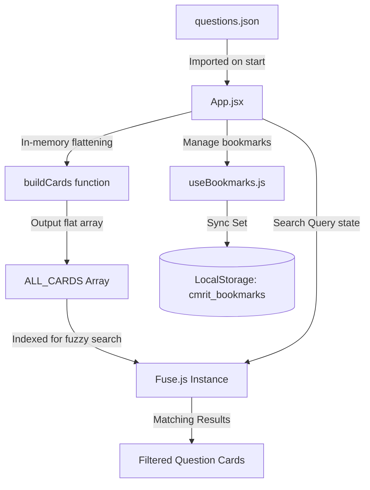

# System Architecture Documentation

The **CMRIT Placement PYQ Portal** is structured as a client-side Single Page Application (SPA). Because it is a department-level utility designed to run on a static server, it does not rely on a backend database. Instead, it processes data in-memory from a static JSON seed file and communicates directly with the Groq API from the browser.

---

## 1. Technology Stack

* **Frontend Library:** React (v19.2.6)
* **Build System & Dev Server:** Vite (v8.0.12)
* **Styling Engine:** Tailwind CSS (v3.4.19)
* **Client-Side Search:** Fuse.js (v7.4.2)
* **AI Provider:** Groq Chat Completions API (`llama-3.1-8b-instant`)
* **State Persistence:** Browser LocalStorage

---

## 2. Directory Structure

Below is the directory map of the project, focusing on the `src/` folder:

```
cmrit_placement/
├── docs/                      # Project documentation (this folder)
├── public/                    # Static assets
├── src/
│   ├── assets/                # Images, icons, and theme assets
│   ├── components/            # Modular React components
│   │   ├── ChatBot.jsx        # Floating Placement Assistant UI
│   │   ├── CompanyGrid.jsx    # Company grid view & detail drawer
│   │   ├── FilterPanel.jsx    # [Orphaned] Filtering panel (not used)
│   │   ├── Navbar.jsx         # Sticky global header
│   │   ├── QuestionCard.jsx   # Question view, bookmarks, AI answers
│   │   ├── QuestionList.jsx   # Grid/list of QuestionCards
│   │   ├── SearchBar.jsx      # Fuzzy search text input
│   │   └── StatsBar.jsx       # [Orphaned] Query result count indicator
│   ├── data/
│   │   └── questions.json     # Primary JSON data containing PYQs
│   ├── hooks/
│   │   ├── useBookmarks.js    # Persistent bookmarks state hook
│   │   └── useGroq.js         # Streaming Groq API fetch client
│   ├── App.css                # [Orphaned] Unused CSS file
│   ├── App.jsx                # Main controller, orchestrator, & layout
│   ├── index.css              # Global styles & Tailwind entry
│   └── main.jsx               # Entrypoint bootstrap (StrictMode)
├── vite.config.js             # Vite build options
├── tailwind.config.js         # Tailwind configuration
└── package.json               # Package manifests and scripts
```

---

## 3. Data Flow & Transformations

The application utilizes a pull-based, local-first data lifecycle:



### Static Data Model (`questions.json`)
The questions are structured as an array of placement interview campaigns:
```json
[
  {
    "id": "2023-24_1",
    "company": "Ellucian",
    "year": "2023-24",
    "technical_questions": [ "Questions from: C++, Java..." ],
    "programming_questions": [ "Code to print Prime numbers..." ],
    "total_questions": 28
  }
]
```

### Transformation (`buildCards`)
Upon launch, `App.jsx` flattens this nested structure using the `buildCards` function:
* Separates `technical_questions` and `programming_questions` into unique cards.
* Generates an ID string for each card in the format: `${company_entry_id}_[T/P]${index}`.
* Resolves types as either `"Technical"` or `"Programming"`.
* The flattened collection is stored in a global memory array `ALL_CARDS`.

---

## 4. Component Hierarchy and State Orchestration

`App.jsx` acts as the main controller. It holds the states:
1. `query` (string): Current search input value.
2. `activeCompany` (string|null): Currently selected company card in the grid.
3. `showBookmarks` (boolean): Flag checking if the user is in "Saved Questions" view.

```
App.jsx (Orchestrator)
 ├── Navbar (displays bookmark count, triggers bookmark view)
 ├── SearchBar (drives query state)
 ├── CompanyGrid (rendered when not searching / bookmarking)
 │    └── QuestionCard (company questions view inside the drawer)
 ├── QuestionList (rendered when searching or bookmarking)
 │    └── QuestionCard (lists filtered/bookmarked questions)
 └── ChatBot (always floating, independent chat state)
```

### Persistence Layer (`useBookmarks.js`)
* Implements a custom hook returning the bookmarks (a Javascript `Set`) and a `toggle` function.
* Synchronizes changes to `cmrit_bookmarks` inside `localStorage`.

---

## 5. Streaming AI Integration (`useGroq.js`)

The AI answer streaming system bypasses complex backend gateways and connects directly to Groq.

1. **Request Formulation:** The components (`QuestionCard.jsx` and `ChatBot.jsx`) call the `chat(messages, onChunk)` function exported by `useGroq`.
2. **REST Call:** Sends a `POST` request to `https://api.groq.com/openai/v1/chat/completions` with `{ stream: true }`.
3. **Stream Decoding:** 
   * Reads from the `ReadableStream` body using a `TextDecoder` reader.
   * Splits chunks by newline to capture lines starting with `data: `.
   * Parses the JSON payload corresponding to `choices[0].delta.content`.
   * Fires the `onChunk` callback with individual tokens and the cumulative string.
4. **Environment Constraints:** Relies on `import.meta.env.VITE_GROQ_API_KEY` defined in local environment files (`.env`).
