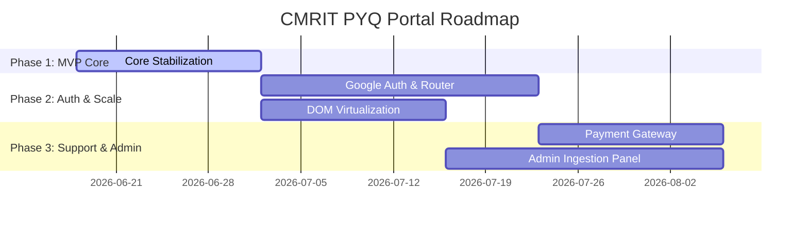

# CMRIT Placement PYQ Portal - Project Roadmap

This document outlines the strategic release phases for the **CMRIT Placement PYQ Portal**, detailing how backlog items (Completed, In Progress, Missing Features, Bugs, and Technical Debt) are mapped into sequential releases. Our focus is delivering a secure, beautiful MVP that scales to **1,000+ students** and supports future enhancements.

---

---

## Phase 1: MVP Core Stabilization & Safety (Current Milestone)
* **Objective:** Ensure security compliance, clean the codebase from legacy clutter, and fix fundamental UI parsing issues.

### Categorized Task Alignment:
* **[Completed] Basic Functionality:** Core search interface, company grid, chat assistant, bookmarks local storage, and statistics metrics.
* **[In Progress] Orphans Removal:** Delete legacy and orphaned components (`FilterPanel.jsx`, `StatsBar.jsx`, and `App.css`) to slim down build bundles.
* **[Bugs] LLM Markdown Fix:** Replace custom regex split parsing in `QuestionCard` and `ChatBot` with a markdown parsing engine (e.g. `react-markdown`) to support code boxes, bullets, and tables.
* **[Bugs] API Failures Graceful State:** Implement error UI fallbacks and retry buttons if the Groq client is rate-limited or offline.
* **[Technical Debt] Groq Key Relocation:** Migrate API queries to a serverless backend proxy function (e.g., Vercel / Netlify Functions) to prevent exposing `VITE_GROQ_API_KEY` in production client bundles.

---

## Phase 2: User Access & Scaling (Release Target: 1,000+ Active Students)
* **Objective:** Secure access using college domain email, add navigation state sharing, and optimize client responsiveness to scale.

### Categorized Task Alignment:
* **[Missing Features] Google Authentication (OAuth 2.0):** Implement college domain registration checks (e.g., student must log in using `@cmrit.ac.in` email) to control site traffic.
* **[Missing Features] URL Router Integration:** Implement `react-router-dom` to support shared deep-links for search queries and specific company pages (e.g. `/company/PhonePe`).
* **[Missing Features] Virtual Scroll Listing:** Integrate virtual list libraries (e.g., `react-window`) to handle listing large search results, improving browser scrolling and rendering memory efficiency.
* **[Technical Debt] TypeScript Migration:** Refactor vanilla JS/JSX to TS/TSX to secure prop structures, JSON shapes, and hook returns.

---

## Phase 3: College Support & Admin Dashboard (Future Expansion)
* **Objective:** Support hosting operations via payment support and implement dynamic content updates.

### Categorized Task Alignment:
* **[Missing Features] Payment Gateway Integration:** Implement a Razorpay or Stripe donation widget, allowing students and alumni to contribute and pay for LLM token usage and hosting costs.
* **[Missing Features] Admin Ingestion Panel:** Create a secure admin route for placement coordinators to easily upload new questions and add new company campaigns.
* **[Missing Features] Granular Categorization:** Introduce advanced drop-down subject tags (e.g., DBMS, DSA, Operating Systems, Networking) to narrow down placement search scopes.
